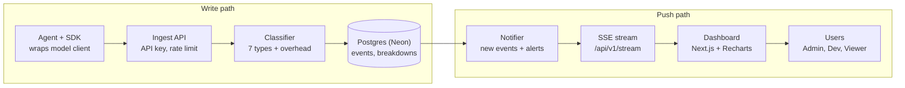

# TokenLens (working name) PRD — Agent token usage and classification

2026-10-27 · CS 6983 Project 2

## Overview

TokenLens tells agent developers where each call's tokens went, not only how many were used in total.

**Problem:** model APIs return only input / output totals in `usage`. Developers cannot see how much of the context is system prompt, tool definitions, history, or retrieved documents, so they cannot optimize cost or context.

**One-line pitch:** a token-usage platform for AI-agent teams. Agents report each call through an SDK or API; the platform splits tokens by structure and shows usage, cost, and budget alerts in real time.

**Goals (this delivery, due 2026-11-12)**

- Support both Anthropic and OpenAI request formats
- Split each call's input tokens into 7 structural categories, with error shown separately as `overhead`
- Team dashboard in real time: usage and cost by project, agent, model, category, and time range
- Push budget-threshold alerts in real time
- Public ingest and query API with API-key auth and Swagger docs
- Meet the course process requirements: TDD, CI/CD, 2 sprints, pair review

**Non-goals**

- No trace trees, prompt replay, or evals (Langfuse-style deep features)
- No billing or payments
- Semantic (topic) classification is stretch only, not required
- Do not proxy production traffic; proxy mode is a demo option only

## Users and roles

Three roles apply inside an Organization and satisfy the "3+ roles" requirement. Permissions are enforced in backend middleware; the frontend only hides UI.

| Capability | Org Admin | Developer | Viewer |
| --- | --- | --- | --- |
| View dashboard and classification reports | ✓ | ✓ | ✓ |
| Create / delete project | ✓ | ✓ | — |
| Create / revoke API key | ✓ | ✓ (own projects only) | — |
| Set budget and alert thresholds | ✓ | — | — |
| Read `model_prices` | ✓ | ✓ | ✓ |
| Edit `model_prices` | ✓ | — | — |
| Invite members and change roles | ✓ | — | — |
| Export CSV | ✓ | ✓ | ✓ |

**Typical users:** a 3–10 person AI app team. Admin is the tech lead and watches monthly cost. Developer cares about their agent's context mix. Viewer is a PM or finance partner.

## Core features

P0 is the minimum set for full Functionality credit. P1 is extra credit. Stretch is only after all P0/P1 work is done.

| Feature | Priority | Notes | Course requirement |
| --- | --- | --- | --- |
| Accounts and organizations | P0 | Register, sign in (JWT, httpOnly cookie), create org, invite members | Auth, 3+ roles |
| Project and API key | P0 | Create project, generate key (shown once, store hash), revoke | Security |
| Usage ingest API | P0 | `POST /api/v1/events`: accept a call body or pre-split segments plus model `usage` | Public API |
| Structured token classification | P0 | Server splits into 7 categories and stores the result (see next section) | Core differentiator |
| Real-time dashboard | P0 | New events push to the page over SSE; totals, stacked category chart, recent calls | Real-time updates |
| Single-call detail | P0 | Open a call to see category shares and cost | — |
| Budget alerts | P1 | Admin sets daily/monthly budgets; notify in real time at 80% / 100% | Real-time updates |
| Optimization hints | P1 | Rule-based tips such as "tool definitions are over 40% of input" or "history is over 50%" | — |
| Node SDK | P1 | `@tokenlens/sdk` wraps Anthropic / OpenAI clients and reports automatically | Public API |
| CSV export | P1 | Export by current filters | — |
| Semantic classification | Stretch | Small model tags paragraphs by topic and aggregates tokens | — |

## Token classification

Classification is determined by request structure, so the same input always yields the same result. The classifier is a pure function `classify(request, usage, provider, countTokens) → Breakdown`. Callers inject `countTokens`; tests use a deterministic counter. This is the project's main TDD surface.

**Input categories**

| Category | Assignment |
| --- | --- |
| `system` | `system` field (OpenAI: messages with role=system/developer) |
| `tool_definitions` | entire `tools` field |
| `history` | all messages before the last user message (excluding tool_result) |
| `tool_results` | `tool_result` blocks anywhere |
| `retrieval` | content blocks tagged `tl_category: retrieval` by the SDK (RAG docs are often inside a user message and cannot be inferred) |
| `user_input` | remaining text in the last user message |
| `attachments` | non-text blocks such as images and PDFs |
| `overhead` | shortfall added when the local sum is below `input_tokens` by ≤ 5% (role markers, formatting). Overcounts, or gaps above 5%, are scaled across categories instead of dumping the whole gap here. |

**Output categories:** `text`, `thinking`, `tool_use`. Cache read / cache write tokens are stored as separate fields and are not part of category splits.

**Counting**

1. Estimate each segment with a local tokenizer: `tiktoken` (exact) for OpenAI models, an approximate tokenizer for Claude.
2. Calibrate to the provider `input_tokens` using `src/lib/classifier/calibrate.ts`: a local shortfall of ≤ 5% becomes `overhead`; a local overcount, or any gap above 5%, scales every category with largest-remainder rounding (ties follow category order). `estimated` is true only when |local sum − target| / target > 5%. If the target is 0, return all zeros and mark estimated when local counts were positive. If the target is > 0 and the local sum is 0, put everything in `overhead` and mark estimated.
3. Category totals always equal the real `input_tokens`, so report totals match the bill.
4. Read unit prices from `model_prices`, including output and cache pricing. Only Admins may edit prices. Show unavailable for unknown prices, never zero.

**Privacy:** raw content storage stays off by default. Store counts and metadata only, not prompts or tool content. Sample retention needs a separate Issue that defines access, retention, and deletion.

## Architecture and data model

A single Next.js app on Vercel holds the UI and API routes. The database is Neon Postgres. Neon is the choice because each PR can get a database branch, which fits Vercel deploy previews and the course "environment management" requirement.

The write path authenticates reports, classifies them, and stores them. The push path sends new events and budget alerts over SSE to dashboards for all three roles.

**Stack**

| Layer | Choice |
| --- | --- |
| Frontend | Next.js (App Router) + TailwindCSS + Recharts |
| Backend | Next.js API routes, Zod request validation |
| Database | PostgreSQL (Neon) + Prisma ORM |
| Auth | JWT in an httpOnly cookie (web); API key via `Authorization: Bearer` (ingest) |
| Real time | Server-Sent Events with automatic reconnect |
| Tests | Vitest (unit), Vitest + test database (integration), Playwright (E2E) |
| API docs | OpenAPI generated from Zod schemas, Swagger UI at `/docs` |

**Data model (main tables)**

| Table | Key fields |
| --- | --- |
| `users` | id, email, password_hash, created_at |
| `organizations` | id, name |
| `memberships` | user_id, org_id, role (ADMIN / DEVELOPER / VIEWER) |
| `projects` | id, org_id, name |
| `api_keys` | id, project_id, key_hash, prefix, created_by, revoked_at |
| `events` | id, project_id, agent_name, model, input_tokens, output_tokens, cache_read_tokens, cache_write_tokens, cost_usd, estimated, created_at |
| `event_breakdowns` | event_id, direction (input / output), category, tokens, cost_usd |
| `model_prices` | model, input_per_mtok, output_per_mtok |
| `budgets` | id, org_id, period (day / month), limit_usd |
| `alerts` | id, budget_id, level (80 / 100), triggered_at, acknowledged_at |

Index `events(project_id, created_at)` and `event_breakdowns(event_id)` so dashboard aggregates stay fast.

**Public API (v1)**

| Method | Path | Auth | Purpose |
| --- | --- | --- | --- |
| POST | `/api/v1/events` | API key | Report one call; return the classification |
| GET | `/api/v1/events` | API key / JWT | Paginated call list |
| GET | `/api/v1/events/:id` | API key / JWT | Classification detail for one call |
| GET | `/api/v1/usage/summary` | API key / JWT | Aggregate by time bucket × category |
| GET | `/api/v1/stream` | JWT | SSE live event stream |
| — | `/api/auth/*`, `/api/orgs/*`, `/api/projects/*`, `/api/budgets/*` | JWT | Internal admin APIs |

The ingest API is rate-limited per API key (600 requests per minute) and returns 429 when exceeded.

## Sprint plan

Two sprints: Sprint 1 is 10/28–11/4, foundations plus "report → classify → store". Sprint 2 is 11/5–11/10, real time, alerts, and polish. 11/11–11/12 is for docs, the demo video, and buffer. Each story is one GitHub issue on the matching milestone. Estimate with Fibonacci story points on a `points:N` label. Owners are filled in during sprint planning so each person has roughly equal points.

**Sprint 1 (milestone: Sprint 1, 10/28–11/4, 24 points)**

| # | User story | Acceptance | Points | Owner |
| --- | --- | --- | --- | --- |
| S1-1 | As a developer, I need the repo, AGENTS.md, and a CI skeleton so every PR is checked automatically | PRs run lint + unit tests; Vercel preview per PR; Neon branch database per PR | 3 | |
| S1-2 | As a user, I want to register and sign in so I can reach my data | Wrong password returns 401; JWT in an httpOnly cookie; unauthenticated dashboard visits redirect to sign-in | 3 | |
| S1-3 | As an Admin, I want to create an organization and invite members by role | Three assignable roles; Viewer creating a project returns 403; non-members cannot see that org's data | 5 | |
| S1-4 | As a Developer, I want to create a project and get an API key | Key shown only at creation; store only the hash; revoked keys return 401 on ingest | 3 | |
| S1-5 | As a Developer, I want Anthropic-format requests split into categories automatically | At least 8 fixture requests match expected splits; categories sum to `input_tokens`; mark `estimated` when the gap is >5% | 5 | |
| S1-6 | As a Developer, I want to report a call through the API | Valid requests return 201 and the split; invalid schema returns 400; over limit returns 429 | 3 | |
| S1-7 | As a team, we need one E2E happy-path test | Playwright: register → create project → get key → report → see the call in the list; run against preview in CI | 2 | |

**Sprint 2 (milestone: Sprint 2, 11/5–11/10, 25 points + stretch)**

| # | User story | Acceptance | Points | Owner |
| --- | --- | --- | --- | --- |
| S2-1 | As a Developer, I want new calls on the dashboard in real time | Appear within 2 seconds with no refresh; reconnect after disconnect | 5 | |
| S2-2 | As a Developer, I want a stacked category chart over time and single-call detail | Filter by project / agent / model / time range; detail page shows tokens and cost per category | 5 | |
| S2-3 | As a Developer, I want OpenAI format split as well, with retrieval tags | All OpenAI fixtures pass; blocks tagged `tl_category: retrieval` go to retrieval | 3 | |
| S2-4 | As an Admin, I want to set a budget and get a live alert when it is exceeded | Notify within 2 seconds at 80% / 100%; same level does not fire twice; non-Admin setup returns 403 | 5 | |
| S2-5 | As an external developer, I want complete API docs | `/docs` shows every v1 endpoint and supports try-it-out | 2 | |
| S2-6 | As a team, we need security scans and automatic deploys | PRs run CodeQL + `npm audit`; merge to main deploys production; pipeline splits lint / test / e2e / deploy | 2 | |
| S2-7 | As a Developer, I want optimization hints and one-line SDK ingest | Show the matching hint when tool definitions >40% or history >50%; wrapping the client reports automatically | 3 | |
| S2-8 | Stretch: as a Developer, I want token mix by topic | Each segment gets a topic tag; it is optional; failure must not break structural classification | 5 | |

If S1-5 or S1-6 is unfinished at the end of Sprint 1, cut S2-7 and S2-8. Do not cut tests.

## Engineering and process

Every rule in this section must leave a visible GitHub trail, because grading only sees the repo.

**TDD (core of Technical Excellence, 60 points)**

- At least two commits per feature: `test: ... (red)` with a failing test, then `feat: ... (green)` with the implementation, plus `refactor:` when needed
- A red commit may fail CI, but only on a feature branch; PRs into main must be green
- Drive the classifier with fixtures: `fixtures/anthropic/*.json` plus expected splits; add a fixture before a new rule

**Test layers**

| Layer | Coverage | Tool |
| --- | --- | --- |
| Unit | Classifier, cost math, permission checks, budget thresholds | Vitest |
| Integration | API route + real Postgres: auth, 403/401/429, storage and aggregates | Vitest + Postgres service in CI |
| E2E | Happy path from sign-up to a live event, plus budget alerts | Playwright against the PR preview |

**CI/CD (GitHub Actions)**

1. lint + typecheck
2. unit + integration (in parallel)
3. Security scans: CodeQL, `npm audit --audit-level=high`, gitleaks
4. Vercel preview (Neon branch database)
5. Playwright against the preview URL
6. Automatic production deploy after merge to main

Environment variables are split across development / preview / production. Secrets live only in Vercel and GitHub Secrets. The repo has `.env.example` only.

**Security**

- Hash passwords with bcrypt; store API keys as SHA-256 hash plus prefix
- Scope every query by org; dedicated integration tests for unauthorized access
- Rate-limit ingest; max body size 1 MB

**Pairing**

- One issue, one branch (`feature/<issue-number>-description`, e.g. `feature/5-anthropic-classifier`). PR titles reference the issue. Partner approval is required before merge (enable branch protection).
- Each person reviews at least 3 PRs per sprint, more than the required 5 across both sprints
- Standups are GitHub Discussions or files under `docs/standups/`. At least 3 per person per sprint, format: yesterday / today / blockers
- Both partners maintain AGENTS.md: TDD rules, category definitions, naming. When the AI repeats a mistake, add a rule and say why in the commit message (evidence for AI Mastery)

## Demo and risks

**10-minute demo script**

1. (1 min) Problem: show a real agent call that returns only two numbers
2. (2 min) Admin creates an org, invites a Developer and a Viewer, and shows Viewer blocked from creating a project
3. (3 min) Run a demo agent with 3 tools and RAG; the call appears on the dashboard live; open detail and show "tool definitions are X%" plus an optimization hint
4. (1 min) Lower the budget and trigger a live alert
5. (1 min) Call ingest from Swagger
6. (2 min) Engineering: show red/green commits, PR review, CI pipeline, and preview deploy

Prefer a real Claude API call for the demo agent (a few cents). Keep a fixture-replay script as a backup while recording.

**Risks**

| Risk | Impact | Mitigation |
| --- | --- | --- |
| Claude has no public local tokenizer, so segment counts are approximate | Category shares have error | Calibrate to the real total and mark `estimated`; document the error source in the README |
| Vercel functions have a max duration, so SSE connections drop on a schedule | Live push gaps | Client reconnects and backfills from the last event id; if still unstable, switch to Pusher's free tier |
| All process evidence must land in 16 days | Agile and TDD scores | Create milestones, issues, and branch protection on day one; write standups the same day |
| Uneven contribution | Individual grade ±10% | Split story points evenly and have both people touch the classifier and the UI |
