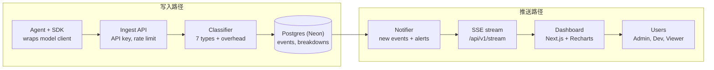

# TokenLens（暂定名）PRD — Agent Token 用量与分类监控平台

2026-10-27 · CS 6983 Project 2

## 概述

TokenLens 告诉 agent 开发者：每次调用的 token 花在了哪里，而不只是一共花了多少。

**问题**：模型 API 的 `usage` 只返回 input / output 总数。开发者看不到 context 里 system prompt、工具定义、对话历史、检索文档各占多少，也就无从优化成本和 context。

**一句话定位**：一个面向 AI agent 团队的 token 用量平台——agent 通过 SDK 或 API 上报每次调用，平台按结构自动拆分 token 类别，实时展示用量、成本与超预算告警。

**目标（本次交付，截止 2026-11-12）**

- 同时支持 Anthropic 和 OpenAI 两种请求格式
- 每次调用的 input token 按 7 个结构类别拆分，误差（overhead）单独显示
- 团队级实时 dashboard：按 project、agent、模型、类别、时间段查看用量与成本
- 预算阈值告警实时推送
- 带 API key 鉴权、有 Swagger 文档的公开上报与查询 API
- 满足课程全部流程要求：TDD、CI/CD、2 个 sprint、结对 review

**非目标**

- 不做 trace 树、prompt 回放、评测（Langfuse 的深层功能）
- 不做计费与付款
- 语义（主题）分类只做 stretch，不是必须项
- 不代理生产流量；proxy 模式只作为 demo 选项

## 用户与角色

三种角色在 Organization 内生效，满足“3+ 角色”要求。权限在后端中间件统一校验，前端只做展示层隐藏。

| 能力 | Org Admin | Developer | Viewer |
| --- | --- | --- | --- |
| 查看 dashboard 与分类报表 | ✓ | ✓ | ✓ |
| 创建 / 删除 project | ✓ | ✓ | — |
| 生成 / 吊销 API key | ✓ | ✓（仅自己的 project） | — |
| 设置预算与告警阈值 | ✓ | — | — |
| Read `model_prices` | ✓ | ✓ | ✓ |
| Edit `model_prices` | ✓ | — | — |
| 邀请成员、修改角色 | ✓ | — | — |
| 导出 CSV | ✓ | ✓ | ✓ |

**典型用户**：一个 3–10 人的 AI 应用团队。Admin 是 tech lead，关心月度成本；Developer 关心自己 agent 的 context 组成；Viewer 是 PM 或财务。

## 核心功能

P0 是拿满 Functionality 分的最小集合，P1 是加分项，Stretch 只在 P0/P1 全部完成后才做。

| 功能 | 优先级 | 说明 | 对应课程要求 |
| --- | --- | --- | --- |
| 账号与组织 | P0 | 注册、登录（JWT，httpOnly cookie）、创建 org、邀请成员 | Auth、3+ 角色 |
| Project 与 API key | P0 | 创建 project，生成 key（只显示一次，库里存哈希）、吊销 | 安全 |
| 用量上报 API | P0 | `POST /api/v1/events`：接收一次调用的请求体或已拆分的分段 + 模型返回的 usage | 公开 API |
| 结构化 token 分类 | P0 | 服务端按 7 类拆分并入库（见下一节） | 核心差异化 |
| 实时 dashboard | P0 | 新事件通过 SSE 推到页面；总量曲线、类别堆叠图、最近调用列表 | 实时更新 |
| 单次调用详情 | P0 | 点开一次调用，看各类别占比和成本 | — |
| 预算告警 | P1 | Admin 设日/月预算；达到 80% / 100% 时实时通知 | 实时更新 |
| 优化建议 | P1 | 规则型提示，如“工具定义占 input 40% 以上”“历史超过 50%” | — |
| Node SDK | P1 | `@tokenlens/sdk` 包住 Anthropic / OpenAI client，自动上报 | 公开 API |
| CSV 导出 | P1 | 按筛选条件导出 | — |
| 语义分类 | Stretch | 用小模型给段落打主题标签，按主题汇总 token | — |

## Token 分类设计

Classification is determined by request structure, so the same input always yields the same result. The classifier is a pure function `classify(request, usage, provider, countTokens) → Breakdown`. Callers inject `countTokens`; tests use a deterministic counter. This is the project's main TDD surface.

**Input 类别**

| 类别 | 归属规则 |
| --- | --- |
| `system` | `system` 字段（OpenAI 为 role=system/developer 的消息） |
| `tool_definitions` | `tools` 字段全部内容 |
| `history` | 最后一条 user 消息之前的所有消息（不含 tool_result） |
| `tool_results` | 任意位置的 `tool_result` 块 |
| `retrieval` | 被 SDK 标记 `tl_category: retrieval` 的内容块（RAG 文档通常夹在 user 消息里，无法自动识别） |
| `user_input` | 最后一条 user 消息中未被归入上述类别的文本 |
| `attachments` | 图片、PDF 等非文本块 |
| `overhead` | Shortfall added when the local sum is below `input_tokens` by ≤ 5% (role markers, formatting). Overcounts, or gaps above 5%, are scaled across categories instead of dumping the whole gap here. |

**Output 类别**：`text`、`thinking`、`tool_use`。cache read / cache write token 作为独立字段记录，不参与类别拆分。

**计数方法**

1. 每个分段用本地 tokenizer 估算：OpenAI 模型用 `tiktoken`（精确），Claude 模型用近似 tokenizer。
2. Calibrate to the provider `input_tokens` using `src/lib/classifier/calibrate.ts`: a local shortfall of ≤ 5% becomes `overhead`; a local overcount, or any gap above 5%, scales every category with largest-remainder rounding (ties follow category order). `estimated` is true only when |local sum − target| / target > 5%. If the target is 0, return all zeros. If the target is > 0 and the local sum is 0, put everything in `overhead` and mark estimated.
3. 各类别之和始终等于真实 `input_tokens`，保证报表总数与账单一致。
4. Read unit prices from `model_prices`, including output and cache pricing. Only Admins may edit prices. Show unavailable for unknown prices, never zero.

**Privacy:** raw content storage stays off by default. Store counts and metadata only, not prompts or tool content. Sample retention needs a separate Issue that defines access, retention, and deletion.

## 技术架构与数据模型

单一 Next.js 应用部署在 Vercel，前端和 API routes 同仓，数据库用 Neon Postgres。选 Neon 是因为它支持每个 PR 自动开一个数据库分支，配合 Vercel deploy preview 正好满足“环境管理”。

上行是写入路径：上报经鉴权、分类后入库；下行是推送路径：新事件和预算告警经 SSE 到达三种角色的看板。

**技术栈**

| 层 | 选型 |
| --- | --- |
| 前端 | Next.js（App Router）+ TailwindCSS + Recharts |
| 后端 | Next.js API routes，Zod 校验请求 |
| 数据库 | PostgreSQL（Neon）+ Prisma ORM |
| 认证 | JWT 存 httpOnly cookie（网页端）；API key 走 `Authorization: Bearer`（上报端） |
| 实时 | Server-Sent Events，断线自动重连 |
| 测试 | Vitest（unit）、Vitest + 测试数据库（integration）、Playwright（E2E） |
| API 文档 | 从 Zod schema 生成 OpenAPI，`/docs` 挂 Swagger UI |

**数据模型（主要表）**

| 表 | 关键字段 |
| --- | --- |
| `users` | id, email, password_hash, created_at |
| `organizations` | id, name |
| `memberships` | user_id, org_id, role（ADMIN / DEVELOPER / VIEWER） |
| `projects` | id, org_id, name |
| `api_keys` | id, project_id, key_hash, prefix, created_by, revoked_at |
| `events` | id, project_id, agent_name, model, input_tokens, output_tokens, cache_read_tokens, cache_write_tokens, cost_usd, estimated, created_at |
| `event_breakdowns` | event_id, direction（input / output）, category, tokens, cost_usd |
| `model_prices` | model, input_per_mtok, output_per_mtok |
| `budgets` | id, org_id, period（day / month）, limit_usd |
| `alerts` | id, budget_id, level（80 / 100）, triggered_at, acknowledged_at |

`events(project_id, created_at)` 和 `event_breakdowns(event_id)` 建索引，保证 dashboard 聚合查询够快。

**公开 API（v1）**

| 方法 | 路径 | 鉴权 | 用途 |
| --- | --- | --- | --- |
| POST | `/api/v1/events` | API key | 上报一次调用，返回分类结果 |
| GET | `/api/v1/events` | API key / JWT | 分页查询调用列表 |
| GET | `/api/v1/events/:id` | API key / JWT | 单次调用的分类明细 |
| GET | `/api/v1/usage/summary` | API key / JWT | 按时间桶 × 类别聚合 |
| GET | `/api/v1/stream` | JWT | SSE 实时事件流 |
| — | `/api/auth/*`、`/api/orgs/*`、`/api/projects/*`、`/api/budgets/*` | JWT | 内部管理接口 |

上报接口按 API key 限流（每分钟 600 次），超限返回 429。

## Sprint 计划

两个 sprint：Sprint 1 为 10/28–11/4，搭好地基并跑通“上报 → 分类 → 入库”；Sprint 2 为 11/5–11/10，做实时、告警和打磨。11/11–11/12 留给文档、demo 视频和缓冲。每条 story 对应一个 GitHub issue，挂到对应 milestone；估算用 Fibonacci story points，以 `points:N` label 记录。Owner 列由两人在 sprint planning 时填，尽量让每人点数大致相等。

**Sprint 1（milestone: Sprint 1，10/28–11/4，共 24 点）**

| # | User story | 验收标准 | 点数 | Owner |
| --- | --- | --- | --- | --- |
| S1-1 | 作为开发者，我需要仓库、AGENTS.md 和 CI 骨架，以便每个 PR 自动检查 | PR 自动跑 lint + unit test；Vercel 为 PR 生成 preview；Neon 为 PR 开分支库 | 3 | |
| S1-2 | 作为用户，我想注册和登录，以便访问我的数据 | 错误密码返回 401；JWT 存 httpOnly cookie；未登录访问 dashboard 跳转登录页 | 3 | |
| S1-3 | 作为 Admin，我想创建组织并按角色邀请成员 | 三种角色可分配；Viewer 创建 project 返回 403；非成员看不到该 org 数据 | 5 | |
| S1-4 | 作为 Developer，我想创建 project 并拿到 API key | key 只在创建时显示一次；库中只存哈希；吊销后用该 key 上报返回 401 | 3 | |
| S1-5 | 作为 Developer，我想让 Anthropic 格式的请求被自动拆分为各类别 | 至少 8 个 fixture 请求得到预期拆分；各类之和等于 `input_tokens`；偏差 >5% 时标记 `estimated` | 5 | |
| S1-6 | 作为 Developer，我想通过 API 上报一次调用 | 合法请求返回 201 及拆分结果；schema 不合法返回 400；超限返回 429 | 3 | |
| S1-7 | 作为团队，我们需要一条 E2E 主流程测试 | Playwright：注册 → 建 project → 拿 key → 上报 → 列表里看到该调用；CI 中对 preview 运行 | 2 | |

**Sprint 2（milestone: Sprint 2，11/5–11/10，共 25 点 + stretch）**

| # | User story | 验收标准 | 点数 | Owner |
| --- | --- | --- | --- | --- |
| S2-1 | 作为 Developer，我想在 dashboard 实时看到新调用 | 上报后 2 秒内无需刷新即出现；断线后自动重连 | 5 | |
| S2-2 | 作为 Developer，我想看到各类别随时间的堆叠图和单次调用详情 | 可按 project / agent / 模型 / 时间段筛选；详情页显示各类 token 与成本 | 5 | |
| S2-3 | 作为 Developer，我想让 OpenAI 格式也能拆分，并支持 retrieval 标记 | OpenAI fixture 全部通过；带 `tl_category: retrieval` 的块归入 retrieval | 3 | |
| S2-4 | 作为 Admin，我想设置预算并在超预算时收到实时告警 | 达到 80% / 100% 时 2 秒内弹出通知；同一级别不重复触发；非 Admin 设置返回 403 | 5 | |
| S2-5 | 作为外部开发者，我想看到完整的 API 文档 | `/docs` 展示全部 v1 接口；可直接 try it out | 2 | |
| S2-6 | 作为团队，我们需要安全扫描和自动上线 | PR 跑 CodeQL + `npm audit`；main 合并后自动部署生产；pipeline 分 lint / test / e2e / deploy 多阶段 | 2 | |
| S2-7 | 作为 Developer，我想看到优化建议，并用 SDK 一行接入 | 工具定义 >40% 或历史 >50% 时显示对应提示；SDK 包住 client 后自动上报 | 3 | |
| S2-8 | Stretch：作为 Developer，我想按主题看 token 分布 | 每段内容获得一个主题标签；可开关；失败不影响结构分类 | 5 | |

Sprint 1 结束时若 S1-5 或 S1-6 未完成，S2-7 和 S2-8 直接砍掉，不压缩测试。

## 工程与流程要求

这一节的每条规则都要在 GitHub 上留下可见痕迹，因为评分只看得见仓库。

**TDD（Technical Excellence 60 分的核心）**

- 每个功能至少两个 commit：先 `test: ... (red)` 提交失败测试，再 `feat: ... (green)` 提交实现，需要时加 `refactor:`
- red commit 允许 CI 失败，但只在功能分支上；合入 main 的 PR 必须全绿
- 分类器用 fixture 驱动：`fixtures/anthropic/*.json` 配预期拆分，新增规则先加 fixture

**测试分层**

| 层 | 覆盖内容 | 工具 |
| --- | --- | --- |
| Unit | 分类器、成本计算、权限判断、预算阈值逻辑 | Vitest |
| Integration | API route + 真实 Postgres：鉴权、403/401/429、入库与聚合 | Vitest + CI 中的 Postgres service |
| E2E | 注册到看到实时事件的主流程、预算告警 | Playwright，对 PR preview 运行 |

**CI/CD（GitHub Actions）**

1. lint + typecheck
2. unit + integration（并行）
3. 安全扫描：CodeQL、`npm audit --audit-level=high`、gitleaks
4. Vercel preview 部署（连 Neon 分支库）
5. 对 preview URL 跑 Playwright
6. main 合并后自动部署生产

环境变量分 development / preview / production 三套，密钥只存 Vercel 和 GitHub Secrets，仓库中只有 `.env.example`。

**安全**

- 密码用 bcrypt；API key 存 SHA-256 哈希和前缀
- 所有查询按 org 隔离，越权访问有专门的 integration 测试
- 上报接口限流；请求体大小上限 1 MB

**结对流程**

- 一个 issue 一个分支（`feature/<issue 编号>-描述`，如 `feature/5-anthropic-classifier`），PR 标题引用 issue，合并前必须由搭档 approve（开启 branch protection）
- 每人每个 sprint 至少 review 3 个 PR，两个 sprint 合计超过要求的 5 个
- standup 以 GitHub Discussion 或 `docs/standups/` 下的文件记录，每人每 sprint 至少 3 条，格式：昨天 / 今天 / 阻塞
- AGENTS.md 由两人共同维护：写入 TDD 规则、分类类别定义、命名约定；每次 AI 犯同类错误就补一条规则，并在 commit message 里说明原因（AI Mastery 的证据）

## Demo 与风险

**10 分钟 demo 脚本**

1. （1 分钟）问题：展示一次真实 agent 调用只返回两个数字
2. （2 分钟）Admin 建 org、邀请 Developer 和 Viewer，演示 Viewer 被拒绝创建 project
3. （3 分钟）跑一个带 3 个工具和 RAG 的 demo agent，dashboard 实时出现调用；点开详情看到“工具定义占 X%”和优化建议
4. （1 分钟）把预算调低，实时触发告警
5. （1 分钟）用 Swagger 直接调用上报接口
6. （2 分钟）工程：展示 red/green commit、PR review、CI pipeline 和 preview 部署

demo agent 优先真实调用 Claude API（花费几美分）；录制时同时准备一个重放 fixture 的脚本作备份。

**风险**

| 风险 | 影响 | 应对 |
| --- | --- | --- |
| Claude 没有公开的本地 tokenizer，分段计数不精确 | 各类占比有误差 | 用真实总数校准并标记 `estimated`；在 README 里写明误差来源 |
| Vercel 函数有最长运行时间，SSE 连接会被定期切断 | 实时推送间断 | 客户端自动重连 + 用最后事件 id 补发；仍不稳定则换 Pusher 免费档 |
| 16 天内要完成全部流程留痕 | Agile 和 TDD 分数 | 第一天就建 milestone、issue、branch protection；standup 当天记 |
| 贡献不均衡 | 个人成绩 ±10% | 按 story points 平均分配，并让两人都碰分类器和前端 |
