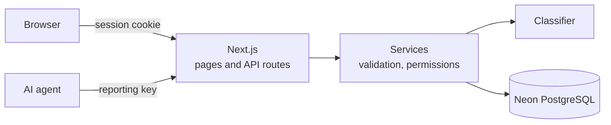
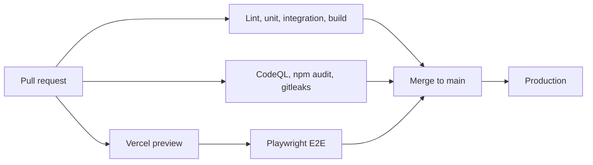

# Architecture

One Next.js app on Vercel serves pages and APIs. Data lives in Neon PostgreSQL.

## Pipeline

| Environment | Database |
| --- | --- |
| Local | Local PostgreSQL |
| CI | PostgreSQL 17 container |
| Preview | Neon branch per pull request |
| Production | Neon main branch |
